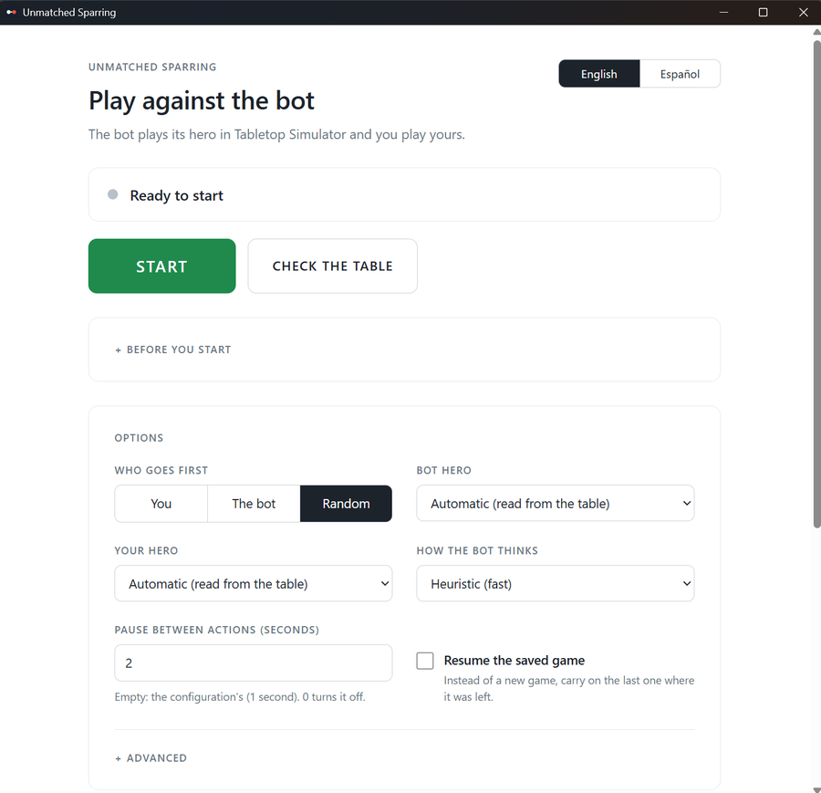

# unmatched-sparring

A sparring bot for [Unmatched](https://restorationgames.com/unmatched/) inside Tabletop Simulator (TTS). You sit at the table, the bot plays the other side: it moves its miniatures, plays its cards, defends, draws and discards on the real table, and talks to you in the TTS chat.

Presentation video: https://youtu.be/9ymhnuhgaZI

## Download and play

No terminal, Python or uv needed:

1. Download **`UnmatchedSparring-Setup-0.7.0.exe`** from the [latest release](https://github.com/ivanlhz/unmatched-sparring/releases/latest) and run it. It installs for your Windows user only and opens the launcher.
2. Open Tabletop Simulator with the **Unmatched Official Tournament Table** savegame ("October 2026 (Hellboy)" version). You sit White, the bot sits Green.
3. Set up both heroes on the table and press **START** in the launcher. **CHECK THE TABLE** reads the table without changing anything and tells you what is missing.



The installer is not code-signed, so Windows SmartScreen may warn you: choose "More info" and then "Run anyway". The rest of this page is for running the bot from source and for contributors.

## Contents

- [Download and play](#download-and-play)

1. [What it is](#1-what-it-is)
2. [Available heroes](#2-available-heroes)
3. [Requirements and setup](#3-requirements-and-setup)
4. [How to play](#4-how-to-play)
5. [Languages](#5-languages)
6. [The two AIs](#6-the-two-ais)
7. [Roadmap](#7-roadmap)
8. [How to contribute](#8-how-to-contribute)
9. [What works and known limitations](#9-what-works-and-known-limitations)

## 1. What it is

A Python program that runs next to TTS and plays one side of an Unmatched game against you.

- It talks to TTS through its **External Editor API** (TCP: it sends to `127.0.0.1:39999` and listens on `39998`). It only sends Lua generated by its own script builders (`sparring/tts/lua.py`); any other string is refused.
- It creates its own panel object (`SparringPanel`) with buttons for you to press. It never touches the Global script of the table.
- It controls **its side of the table only**: its hand, deck, discard, miniatures and health dials. For the cards and pieces of your side it reads the table and trusts what it sees; it moves your things only when a rule makes it (and it says so).
- **No cheating.** The bot never reads your hidden hand. It knows your discard pile, the size of your hand and the cards you have played. It sees your cards only when a card effect lets it look (and then it remembers only what it legitimately saw, discounting what you later play or discard). The search AI is tested for this: two games identical except for your hidden hand give the same decision.
- The bot is the only authority on the rules for its own side. The table is the authority on where things are: the bot re-reads it constantly and adopts what it shows.

## 2. Available heroes

Twenty-three heroes have data, effects and table configuration: the five of the Hellboy box, the four Teenage Mutant Ninja Turtles (Adventures: Teenage Mutant Ninja Turtles box), Doctor Strange, Houdini, Bigfoot, Daredevil, Luke Cage, Bullseye, Golden Bat, Dr. Jill Trent, She-Hulk, Tomoe Gozen, Ciri, Eredin, Sinbad and Yennefer & Triss. Each can be played **by the bot** and **by the human**, in any combination, as long as the two sides are different heroes (their miniature and deck GUIDs would be the same).

| Hero | slug | HP | Notes |
|---|---|---|---|
| Medusa | `medusa` | 16 | Ranged. Harpies. The reference implementation. |
| Hellboy | `hellboy` | 18 | Two forms (OCCULT DETECTIVE / ANUNG UN RAMA) driven by the Destiny count, plus Lobster Johnson. |
| Abe Sapien | `abe-sapien` | 13 | Intuition tokens. |
| Baba Yaga | `baba-yaga` | 13 | |
| Liz Sherman | `liz-sherman` | 16 | Ranged. WILDFIRE, burning cards. |
| Leonardo | `leonardo` | 16 | TMNT. Melee, Splinter. TEAM TACTICS (move any fighter 1 space at the start of your turn). Shares Medusa's CardID range: told apart by the deck images. Not live-tested yet. |
| Donatello | `donatello` | 14 | TMNT, with Metalhead. INVENTIVE: draws a second card when he maneuvers and tucks the inventions he plays under his hero card (their bonus lasts the whole game). Not live-tested yet; see [docs/heroes/donatello.md](docs/heroes/donatello.md). |
| Michelangelo | `michelangelo` | 14 | TMNT. Melee, with April O'Neil (ranged sidekick). PIZZA PARTY: draw after attacking or scheming; hand size 3. Shares Medusa's CardID range: told apart by the deck images. Not live-tested yet. |
| Raphael | `raphael` | 17 | Melee, with Casey Jones (ranged). TMNT. ANGER ISSUES (an action back on the first lost combat of the turn). Played live as the human against the bot's Hellboy; most of its cards are still unchecked on the table. |
| Doctor Strange | `doctor-strange` | 14 | Marvel (Brains and Brawn). Ranged, with Wong (ranged). DARK PACT (after a combat in which he played a card, 1 damage to him to put it at the bottom of the deck and draw 1: the panel offers it only then), BLIND BOOST, The Mists of Munnopor (replaces the rival's attack with a card from its deck). Shares Medusa's CardID range: told apart by the deck images. Not live-tested yet; see [docs/heroes/doctor-strange.md](docs/heroes/doctor-strange.md). |
| Houdini | `houdini` | 14 | Houdini vs. The Genie. Melee, with Bess. ESCAPE ARTIST (boosting a Maneuver, he is placed on any empty space) and six cards with a BOOSTED WITH effect when spent as a boost. His deck is sheet 178: no CardID is shared with another hero. Not live-tested yet; see [docs/heroes/houdini.md](docs/heroes/houdini.md). |
| Daredevil | `daredevil` | 17 | Marvel (Hell's Kitchen). Melee, no sidekick, a deck of 22 cards (23 objects in the save with the character card). Ability: with 2 or fewer cards in hand you may BLIND BOOST (declared 0 or 1 up front; the bot moves the card from your deck); Take A Knee (discard the top card, heal its BOOST: one button), Devil of Hell's Kitchen (the last 4 cards played back into the deck), Through Adversity (move through rivals, 1 damage to each). Shares Medusa's CardID range: told apart by the deck images. Not live-tested yet; see [docs/heroes/daredevil.md](docs/heroes/daredevil.md). |
| Bigfoot | `bigfoot` | 16 | Robin Hood vs. Bigfoot. Melee, with The Jackalope. At the end of your turn, if no opposing fighter is in Bigfoot's zone, you may draw 1 card (the panel asks Yes / No only then). Jackalope Horns is the Jackalope's scheme: it moves and hits for 2. His deck is sheet 176, shared with Medusa, the turtles and Doctor Strange: told apart by the deck images. Not live-tested yet; see [docs/heroes/bigfoot.md](docs/heroes/bigfoot.md). |
| Luke Cage | `luke-cage` | 13 | Marvel (Redemption Row). Melee, with Misty Knight (ranged). Takes 2 less combat damage from attacks, and a defender who takes no damage wins even without a card. Power Man (moves the attacker and hurts the fighters it crosses), Got My Back? (Misty swaps with him and he takes the blow), Where's My Money? (placed next to the nearest foe). Shares Medusa's CardID range: told apart by the deck images. Not live-tested yet; see [docs/heroes/luke-cage.md](docs/heroes/luke-cage.md). |
| Bullseye | `bullseye` | 14 | Hell's Kitchen. Ranged, no sidekick. Attacks from up to 5 spaces away, ignoring zones (the HeroDef parameter `reach_spaces`). Cards that read "if you already won a combat this turn", one that counts as a win (Arrogant But Effective) and a free BOOST that draws a card when declined (I Never Miss). His deck is sheet 176, shared with Medusa, the turtles, Doctor Strange and Bigfoot: told apart by the deck images. Not live-tested yet; see [docs/heroes/bullseye.md](docs/heroes/bullseye.md). |
| Golden Bat | `golden-bat` | 18 | Adventures: Tales to Amaze. Melee, move 3, no sidekick. THE FIRST SUPERHERO: +2 to the value of his attacks if you have not taken a Maneuver action this turn (a HeroDef passive with `unless: maneuver`, read by the combat and by the bot's estimates). Cards that stop all movement for the turn (Terrifying Roar), score a zone-wide punch, look at and reorder the rival's top 3 cards (Sight Beyond Sight; the bot cannot read a human's real deck), and a DURING value that depends on the zones of the space he started the turn in (Like a Flash of Golden Light). His deck is sheet 176, shared with Medusa, the turtles, Doctor Strange, Bigfoot, Daredevil, Luke Cage and Bullseye: told apart by the deck images. Not live-tested yet; see [docs/heroes/golden-bat.md](docs/heroes/golden-bat.md). |
| Dr. Jill Trent | `jill-trent` | 13 | Adventures: Tales to Amaze. Melee, with Daisy (melee). GADGETOLOGY: at the start of your turn you activate one of two gadgets (the panel asks; the bot decides) and when Jill attacks it resolves: the Hypnoray Blaster (lower printed value than the rival's: reveal the top card of their deck and add its BOOST to your attack) or the Ultrabiotic Tonic (higher printed value: Jill recovers 1). Daisy borrows the active gadget through Sisters In Arms. Cards that reveal the top cards of the decks (Battle of Wits, Insightful Deduction), freeze the rival's value (Stasis Diffuser) and a defense that lasts one combat (Indestructible Cloth). Her deck is sheet 176, shared with Medusa, the turtles, Doctor Strange, Bigfoot and the Marvel decks: told apart by the deck images. Not live-tested yet; see [docs/heroes/jill-trent.md](docs/heroes/jill-trent.md). |
| She-Hulk | `she-hulk` | 20 | Marvel (Brains and Brawn). Melee, no sidekick. JUST THROW SOMETHING (at the start of her turn she may discard a card to deal its BOOST in damage to a fighter in her zone: the bot decides it, the human does it on the table). The Savage She-Hulk (9 for an additional action: the new op `spend_action`), Lady Justice (discards the top card of the OPPONENT's deck and adds twice its BOOST: the bot moves your real top card after one button), Legalese (the opponent of the winner chooses: both draw or both discard), Cease and Desist (4 attacking, cancels the rival's effects). Shares sheet 176 with Medusa, the turtles, Doctor Strange, Bigfoot and the Hell's Kitchen heroes (told apart by the deck images). Not live-tested yet; see [docs/heroes/she-hulk.md](docs/heroes/she-hulk.md). |
| Tomoe Gozen | `tomoe-gozen` | 14 | Sun's Origin. Ranged, no sidekick. ATTACK OF OPPORTUNITY (when an opposing hero leaves her zone, by any means, it takes 1 damage: the event `left_zone`; the bot prices it and the human's moves by hand are read at the next button). Witness My Last Battle can only target an adjacent fighter, is played face up and ends the turn; Deeds Of Valor caps her combat damage at 2; Lord Kiso's Final Stand moves her through sidekicks; Five Against Thousands comes back to the hand. Her deck is sheet 176, shared with Medusa, the turtles, Doctor Strange, Bigfoot, Daredevil, Luke Cage and Bullseye: told apart by the deck images; her life dial has Donatello's GUID (`ca8e35`), told apart by the dial's name. Not live-tested yet; see [docs/heroes/tomoe-gozen.md](docs/heroes/tomoe-gozen.md). |
| Ciri | `ciri` | 15 | The Witcher: Steel & Silver. Melee, with Ihuarraquax (melee, 7). The SOURCE is the number of Source cards (the orb on the art band) in her discard pile, shown on the bag's Source dial: Lion cub of Cintra, Zireael, Pushed to the brink, Child of the Elder Blood and The lady of space and time apply the highest tier it reaches; UNCONTAINABLE POWER (Source 7: no effect of her cards can be canceled). Channel the source (give up Source cards for +2 each), Searching strike (search the deck for a Source card, shown to the rival), Bane of the Aen Elle and Blink (moves through rivals), Unicorn ally (an ONGOING that draws after every combat). Her deck is sheet 176, shared with Medusa, the turtles, Doctor Strange, Bigfoot, Daredevil, Luke Cage, Bullseye, Golden Bat, Jill Trent, She-Hulk and Tomoe Gozen: told apart by the deck images. Not live-tested yet; see [docs/heroes/ciri.md](docs/heroes/ciri.md). |
| Eredin | `eredin` | 14 | The Witcher: Realms Fall. Melee, with four Red Riders (1 life each). KING OF THE WILD HUNT: while no Red Rider is alive he is ENRAGED (+1 to every combat card of his, move 3). Several cards are paid with a Red Rider (Icy Guile ignores the rival's value, Foul Purpose returns to the hand: the panel asks which Rider by the name of its miniature); Portal Defense swaps him with a friendly fighter, who becomes the defender; enraged, Implacable may attack and Foul Purpose targets a fighter in any space; Might Of The Aen Elle makes him immune to effect damage. His deck is sheet 176, shared with Medusa, the turtles and the other decks of that sheet: told apart by the deck images. Not live-tested yet; see [docs/heroes/eredin.md](docs/heroes/eredin.md). |
| Sinbad | `sinbad` | 15 | Battle of Legends, Volume One. Melee, with The Porter. When you maneuver, your fighters may move +1 space for each VOYAGE card in your discard pile (the bot plans with it; the human gets a chat hint). The seven VOYAGE attacks are worth 2 plus the other VOYAGE cards in the discard pile and each has its own AFTER (Voyage Home takes the others back to the hand). The bag holds a Voyages counter dial the bot does not write. His deck is sheet 176, shared with Medusa, the turtles and others: told apart by the deck images. Not live-tested yet; see [docs/heroes/sinbad.md](docs/heroes/sinbad.md). |
| Yennefer & Triss | `yennefer-triss` / `triss-yennefer` | 14 | The Witcher: Realms Fall. Ranged; one deck, two variants: the player picks which heroine is the hero (14 HP) and the other is the 6 HP ranged sidekick. `yennefer-triss`: SORCERESS OF VENGERBERG (Yennefer may BOOST her attacks, not cancellable); `triss-yennefer`: MERIGOLD THE FEARLESS (after Triss plays a scheme, 2 damage to an adjacent fighter). Incinerate is Yennefer's card, Merigold's Hailstorm Triss's; Advisor to the king's ONGOING adds 1 to your BOOST values; Lodge of sorceresses makes both players reveal a card and draw its BOOST. The variant is told by the hero miniature out of the bag (no pre-game-gate question yet). Shares sheet 176; told apart by the deck images. Not live-tested yet; see [docs/heroes/yennefer-triss.md](docs/heroes/yennefer-triss.md). |

Where this comes from: `data/heroes/<slug>.json` (hero sheet and card list, generated by `tools\import_hero.py`), `data/heroes/effects/<slug>.json` (card effects in a small DSL, see [docs/effects-dsl.md](docs/effects-dsl.md)), and `data/tts/<slug>.json` (GUIDs and images of each hero's pieces in the tournament savegame). Per-hero notes and open rules questions are in [docs/heroes](docs/heroes).

How each hero is chosen: `bot_hero` / `human_hero` in `config\table.json`, or `--bot-hero SLUG` / `--human-hero SLUG` on the command line. The default is `"auto"`: at start-up the bot reads the table (read-only) and looks for loose Decks or Cards whose CardID falls in a hero's range, assigns each pile to the side whose deck spot is nearest, and prints a line such as `Detected heroes: bot Medusa, human Liz Sherman` (console messages follow the chosen language). If it cannot tell (nothing found, several candidates on one side, the same hero on both sides) it refuses to start (exit code 2) and lists what it saw. Priority: command line, then the value written in the config, then (with `--resume`) the heroes of the saved game, then detection. If the table cannot be read it falls back to Medusa (bot) and Hellboy (human) with a warning.

Status: the data and effects of all twenty-three heroes are verified against the real cards in the tournament savegame, and the test suite plays them against each other on a fake table (the turtles, Doctor Strange, Houdini and Bigfoot against every other hero, in both seats, with a passive and an attacking human). Played live in real TTS, end to end: the bot's Hellboy against a human Liz Sherman, Baba Yaga and Raphael; the bot's Liz Sherman and Baba Yaga against a human Baba Yaga and Liz Sherman; Medusa's Harpies and fallen pieces confirmed. Abe Sapien, Leonardo, Donatello, Michelangelo, Doctor Strange, Houdini and Bigfoot have not been played live yet, so treat them as less proven; [docs/live-checklist.md](docs/live-checklist.md) lists what is still unchecked per hero.

Limitations:

- The human side is limited to those twenty-three heroes. The detector also recognises the decks of the other 78 heroes of the tournament savegame (`data/catalog/heroes.json`), but only to give a clear message such as `The human plays Bruce Lee, which the bot cannot play yet. Playable heroes: ...`. Letting the human play any catalog hero (the bot would only need its values and hand counts) is feature F19, still in the backlog.
- Which cards of your hero does the bot resolve for you? Mostly none: you apply your own card effects on the table, and the bot checks the important ones (movements, discards, draws) against its own rules engine and tells you what to do. See [How to play](#4-how-to-play).
- Heroes outside the roster need effects, a card sheet and table data written first (see [Adding a hero](#adding-a-hero)). A bot hero without coded effects would announce that its ability "is not coded yet" and play by card value and boost only.

### Maps

The bot plays on the map that is on the table: at start-up it reads the loose boards, recognises the map by its image (`data/maps/catalog.json`) and uses that board's real GUID, so a map taken out of its bag in the official save works whatever GUID TTS gave it. The save's three locked pad boards are not maps and are ignored. `board` in the configuration only matters for the offline simulator. If the board is unknown, needs tokens or doors, or is not confirmed yet, the bot refuses to start and says which map it saw and which ones it supports (`--read-only` does the same check). Two maps on the table at once are refused too; leave only the one you play.

**Supported (2)**: B.P.R.D. Headquarters (played live) and Azuchi Castle (data made earlier with `tools/fit_map.py`, not played live).

**Extracted, waiting for the map check (14)**: Fayrlund Forest, Globe Theatre, Marmoreal, Pandemonium, Sarpedon, Sherwood Forest, Streets Of Novigrad, Sunnydale High, T. Rex Paddock, Technodrome, The Bronze, Tsing Shan Monastery, Yukon, Yukon 1900. Their adjacency, zones and starts were read from the map pictures by [tools/import_map.py](tools/import_map.py) and are known to contain mistakes (a sample of four had wrong or missing edges), so each is written `"verified": false` and the bot refuses it ("pending the map check") until a person confirms it in the map checker below.

**Not extracted cleanly (15)**: Baskerville Manor, Hanging Gardens, Kaer Morhen, King Solomon's Mine, McMinnville, OR, Naglfar, New York City, Point Pleasant, Raptor Paddock, Santa's Workshop, Soho, The Alamo, The White House, Thrilla In Manila, Venice. Their data files say `"playable": false` and why (a space left with one neighbour, a disconnected graph, a zone count that does not match). They can be fixed and confirmed in the map checker too. Naglfar is two ships joined by printed portal icons that need edges added by hand.

**Excluded because they need tokens or doors (6)**: Helicarrier, Hell's Kitchen, Navy Pier, Sanctum Sanctorum and The Raft (each has a "Battlefield Items" bag in the save) and Heorot (a Doors bag sits next to it). The bot has no tokens or doors, so it refuses them.

**Map checker.** The map art belongs to Restoration Games and is not in this repository, so the checker works on pictures you keep locally. Download them once with the importer (it reads the save, never writes it) into a folder outside the repo, then start the checker on that folder:

```powershell
.venv\Scripts\python tools\import_map.py --save "<save>.json" --images C:\path\map-images --out data\maps --check-dir C:\path\map-checks   # only to download the pictures
.venv\Scripts\python tools\map_checker.py --images C:\path\map-images --expected ..\unmatched-memory\data\maps.json
```

Open http://127.0.0.1:8765 (localhost only; `--port` changes it, `MAP_IMAGES_DIR` can replace `--images`; the folder must hold `<imageKey>.img` files and cannot be inside the repo). Pick a map: its picture appears with every space numbered, the edges, the zones and the starts. Click one space and then another to add or remove the edge between them; with a space selected, tick its zones or make it start 1-4. **Check** re-runs the structural checks (edges symmetric, graph connected, a zone on every space, the published space and zone counts, starts 1 and 2 on different spaces); **Confirm** re-runs them and, if they pass, writes `data/maps/<key>.json` with `"verified": true` and marks the map supported, so the bot will play it. Four more modes edit what the picture cannot show: **Passage** (key P: secret-passage groups), **Bonus** (key B: click the attacker's space, then the one it hits: high ground), **One-way** (key O: click A then B on an existing edge, repeat to cycle A to B only, B to A only, two-way; shown as a red arrow) and **Hazard** (key H: click A then B on an existing edge, repeat to cycle 1, 2, 3 damage, none; a fighter loses that much the first time in a turn it crosses any hazard edge, and only once per turn in all: later crossings that turn are free, placements never pay; shown as a pink dashed line). Pandemonium records its seven electric edges (16-13, 18-9, 8-10, 10-7, 5-4, 27-2, 26-2, 1 damage each); three of them (16-13, 5-4, 27-2) and the plain edge 13-14 carry a T-Rex icon, so a big two-space hero cannot straddle them, but T-Rex is not modelled. Maps already confirmed (supported) show read-only; start the checker with `--allow-reconfirm` to change one. Re-running the importer with `--overwrite` keeps confirmed maps unless `--force-unverify` is also given. Commit the changed `data/maps` files, never the pictures.

Secret passages (the padlock spaces) are recorded as `passages` groups: Baskerville Manor `[0, 10, 23, 31]`, The White House `[7, 10, 11, 15]`, King Solomon's Mine `[0, 2, 4, 5, 11, 18]`. The printed rule (Cobble & Fog rulebook p. 16, repeated for The White House in the Restoration Games one-pager): a fighter can move from one space with a secret passage to any other, as if adjacent, and they are not adjacent for anything else. The White House and King Solomon's Mine ids were read off the pictures, and King Solomon's Mine's rule text was not found, so it is assumed to be the same.

Not enforced by the bot, on any map: the save carries no rule text for the maps, so any special rule a map may have in the official rulebook is not enforced. The only mark I can see is an orange claw-and-exclamation icon printed on some connectors (for example Azuchi Castle, Fayrlund Forest, Globe Theatre, Pandemonium, Streets Of Novigrad, T. Rex Paddock, The Bronze, Technodrome). What those connectors mean is unknown: the bot treats them as ordinary edges, and that only becomes true for the new maps once a person has confirmed them in the checker. The save also has two small loose boards, Phone Booth and Bathroom Stall, and a second Doors bag with the generic components; none is tied to a map in the save, so I could not tell whether one of the maps uses them.

## 3. Requirements and setup

You need:

- Windows (the commands below are PowerShell), Python 3.11 (the project venv uses 3.11.15) and [uv](https://docs.astral.sh/uv/).
- Tabletop Simulator with the **Unmatched Official Tournament Table** savegame, the "October 2026 (Hellboy)" version, loaded. Put a copy of the savegame in `saves\` (that folder is git-ignored; some importer tools read it). The bot does not need the file to play; the table in TTS is what matters. The official save works as it comes: at start-up the bot [prepares the table itself](#official-save-set-up) (it creates the two discard zones, which that save does not have, and removes the loose decks, d20, Dice Cannon and clocks it does not need).
- The seats: **the bot is Green, you are White**. The config holds the positions measured on that table (hands, discard zones, deck spots, combat spots, panel).

Install:

```powershell
git clone <this repository>
cd unmatched-sparring
uv venv
uv pip install -r tests\requirements.txt       # only needed to run the tests; the bot itself uses the standard library
```

There is no package metadata in the repository: the bot runs on the standard library alone. `pytest` and `lupa` (a Lua interpreter used to test the generated TTS scripts) are test-only, pinned in `tests\requirements.txt`.

### Main keys of `config\table.json`

The file holds what belongs to the **table**; everything that belongs to a **hero** (miniature GUIDs, health dials, deck, tokens, CardID range, names) comes from `data/tts/<slug>.json`. The file carries long `_notes` explaining each value. (The file used to be called `partida.json`; that name is still accepted, with a one-line deprecation notice.) The most useful keys:

| Key | Meaning |
|---|---|
| `language` | `"es"` (default) or `"en"`. See [Languages](#5-languages). |
| `bot_hero`, `human_hero` | A hero slug or `"auto"` (detect from the table). |
| `board`, `board_guid` | `bprd-hq` / `ec6f27`: only the fallback for the offline simulator; with TTS the map and its GUID are read from the table (see [Maps](#maps)). |
| `bot_seat`, `human_seat` | `Green` / `White`. |
| `bot_card_spot`, `human_card_spot` | Where the face-down combat cards are. |
| `bot_ongoing_spot`, `human_ongoing_spot` | Where ONGOING schemes are kept. |
| `bot_tuck_spot`, `bot_removed_spot` | Donatello only: where the bot lays the inventions it tucks under its hero card and the cards it removes from the game (outside its discard and combat zones; estimates). |
| `bot_discard_zone`, `human_discard_zone`, `bot_discard_spot/step/rows/bounds` | Discard zones. The bot lays its discards in an ordered grid so you can read the order of play. |
| `discard_zone_rot_y`, `bot_discard_zone_spawn`, `human_discard_zone_spawn` | Transform the bot creates a missing discard zone with (and straightens an existing one to). See [Official save set-up](#official-save-set-up). |
| `remove_table`, `remove_table_limits` | Loose objects the bot destroys at a fresh start (GUID -> expected TTS object name: decks, d20, Dice Cannon, clocks) and the central table rectangle they must lie in. |
| `bot_deck_spot`, `human_deck_spot` | Draw piles (also used by hero detection). Without a deck zone the bot takes the nearest face-down deck or card within `deck_radius` (2.9) of the spot. |
| `bot_deck_zone`, `human_deck_zone` | Optional. GUIDs of Scripting zones over each draw pile; see [Deck zones](#deck-zones-optional). |
| `dead_spot`, `human_dead_spot` | Where fallen miniatures are put aside. |
| `look_spot`, `look_step`, `bot_row_spot`, `bot_row_step` | Rows where the bot lays out cards for look-at-hand effects. |
| `panel_position`, `panel_scale` | Where the panel floats and how big it is. |
| `off_board_dist` | A piece farther than this from every space counts as off the board. |
| `bot_pause` | Seconds the bot waits after each action (default 1.0, 0 turns it off). |
| `action_announce_hold`, `wildfire_hold`, `ongoing_hold` | Seconds the bot shows what it is about to do before it does it (2.0, 3.0 and 1.5; 0 turns each off). |
| `batch`, `live_ui` | Fast mode (one TTS message per button) and the live panel (status line, buttons by state, on-screen announcements). Both are `true` when the file does not mention them (`false` only in the bare `SessionConfig` of the code). |
| `setup`, `mulligan_bot`, `mulligan_human` | Run the guided set-up; allow the one-time mulligan (all `true`). |
| `start_spaces` | Force the start spaces (keys `bot` / `human`). Normally deduced from the table. |
| `unpack` | `true` takes missing pieces out of the hero's inner bag (see `--unpack`). |
| `ai`, `ai_time_budget`, `ai_seed`, `ai_eval` | AI choice and tuning. See [The two AIs](#6-the-two-ais). |

A value of `"TODO"` has to be filled in by hand after the first `--read-only` run (the bot will not play until it is).

#### Official save set-up

The community save "Unmatched Official Tournament Table October 2026 (Hellboy)" is played as it comes. It differs from the author's own "pre-sparring" table in two ways, and the bot fixes both when it starts:

- **Discard zones.** The official save has no Scripting zones over the discard piles. If the GUID in `bot_discard_zone` / `human_discard_zone` is not on the table, the bot creates the zone with the position and scale in `bot_discard_zone_spawn` / `human_discard_zone_spawn` and **rotation 0, 270, 0 (`discard_zone_rot_y`): created straight**. TTS gives the new zone its own GUID; the bot uses it for the session and keeps it in its state file (`zones_live`), so `--resume` finds the same zone. `config	able.json` is never rewritten. A zone that is on the table (the hand-made `906a7a` / `b7a0b8` of the pre-sparring save, which were slightly crooked at 269.09 / 269.43 degrees) is only straightened to the same rotation. The bot says in the chat which zones it created or straightened. Remove a `*_spawn` key to stop the bot from creating or straightening that zone.
- **A clean table.** The bot keeps the main table empty except for the two hand cards counters. It has a list of loose objects (`remove_table`): two 78-card decks (`addeca`, `cb6cbc`) and a d20 (`65be8d`) in the centre where the B.P.R.D. HQ board goes, the locked Dice Cannon (`5085eb`) and two digital clocks (`6126d5`, `790396`). At a fresh start (never with `--resume`) it **destroys** each of them, and says so in the chat, only if the object with that GUID is the expected kind (TTS can reuse a freed GUID for something else), lies inside the central table (`remove_table_limits`, |x| <= 26 and |z| <= 36) and is not a GUID the bot uses; anything that fails a check is left alone and reported. It works strictly by GUID, never by area, and an absent GUID is skipped. This applies to **any table**, including the author's pre-sparring one, which has the same two clocks. The hand zones, the table board and the counters are never touched. Objects are deleted from the running TTS game only; the save file on disk is untouched, so loading it again brings them back.

The created zones belong to the running TTS game. If you load a different save while the bot runs, they are gone and the bot stops with the missing-GUID message; start it again.

#### Deck zones (optional)

TTS gives a deck a new GUID whenever it is re-formed (gathering the cards back by hand, a restart, the last card turning into a loose card), and a deck that someone nudged can lie farther than `deck_radius` from its spot. A deck zone makes the lookup exact: when `bot_deck_zone` / `human_deck_zone` is set, the bot looks for that side's deck (or its last loose card) **only inside the zone**, whatever its GUID. It is the same idea as the discard zones.

Create each zone once, in TTS:

1. Open the Scripting zone tool (Zones menu, top bar, Scripting) and drag a rectangle over the deck spot, a little bigger than a card (about 3 x 4 units). Keep it clear of the discard zone and the hand zones.
2. Put the deck inside it (face down).
3. Right-click the zone, Scripting, and copy its GUID.
4. Write it in `config\table.json`: `"bot_deck_zone": "<guid>"` and `"human_deck_zone": "<guid>"`. Leave a key out to keep the spot search for that side.
5. Run `--read-only` to check: each side should report its deck as found inside its zone. At start-up the bot refuses a zone GUID that does not exist or is not a Scripting zone, and warns if the zone overlaps a hand or discard zone (only what is face down in a deck zone counts as the deck, so a face-up discard there is still read as discard).

Without zones the bot adopts the GUID the table shows at start-up (and when resuming, if the saved one is gone), so a re-formed deck is still found. The zone is the deck's only home: if the deck is moved out of it the bot says where it looked and asks you to put it back.

### First run: read-only

```powershell
uv run python -m sparring.play --config config\table.json --read-only
```

This only reads the table and prints a report (objects found, distances, detected heroes). It changes nothing in TTS. Use it to check that every GUID is found and to calibrate positions such as `off_board_dist`, `dead_spot` or the look rows. [docs/live-checklist.md](docs/live-checklist.md) is the step-by-step checklist (in Spanish) for the first live session.

## 4. How to play

### Launching

```powershell
# play; Ctrl+C quits cleanly (floor labels and the panel are removed)
uv run python -m sparring.play --config config\table.json --first human

# resume after closing the bot or reloading TTS (state is saved after every button)
uv run python -m sparring.play --config config\table.json --resume
```

| Option | What it does |
|---|---|
| `--config FILE` | Table configuration (default `config\table.json`). |
| `--read-only` | Read the table, print a report, change nothing. |
| `--first human\|bot\|random` | Who goes first. Default `random` (a draw is announced). |
| `--seed N` | Seed for the draw and the decks (random if absent). |
| `--resume` | Continue the saved game. Refuses a save from another table or an old format with a clear message. |
| `--bot-hero SLUG`, `--human-hero SLUG` | Force the heroes (`medusa`, `hellboy`, `abe-sapien`, `baba-yaga`, `liz-sherman`, `leonardo`, `donatello`, `michelangelo`, `raphael`, `doctor-strange`, `daredevil`, `luke-cage`, `bullseye`, `golden-bat`, `houdini`, `bigfoot`, `jill-trent`, `she-hulk`, `tomoe-gozen`, `sinbad`, `eredin`, `ciri`, `yennefer-triss`, `triss-yennefer`; not the same on both sides). |
| `--language es\|en` | Language of the panel and the chat. |
| `--ai heuristic\|ismcts`, `--ai-time SECONDS` | Which AI plays the bot (see [The two AIs](#6-the-two-ais)). |
| `--bot-pause SECONDS` | Pause after each bot action (default 1.0, 0 turns it off). |
| `--unpack` | Before playing, take what is missing from each hero's inner bag (never combined with `--resume`; never from an infinite bag). Also `"unpack": true` in the config. |
| `--timing` | Print, per button and per bot action, how many messages went to TTS and how long they took. |
| `--state FILE` | Save file (default `state\session.json`). A plain-text game log, `session.log`, is written next to it. A save at the old `estado\sesion.json` (and its `partida.log`) is moved to the new names once, with a notice. |
| `--send-port`, `--listen-port` | Use other ports than 39999 / 39998. |
| `--launcher` | Used by the desktop launcher: UTF-8 output, `[sparring:status]` lines, and a `quit` line on stdin (or stdin closing) stops cleanly like Ctrl+C. |

### Desktop launcher (no terminal)

For players who do not program: `launcher\` is a Windows app (Electron) with START / STOP buttons, the options above in a form, a table check button (`--read-only`) and the bot's console in the window, in English (default) or Spanish, switchable at the top of the window. Its installer bundles the bot as a standalone executable built with PyInstaller, so the player's PC needs neither Python nor uv. From that executable the save goes to `%LOCALAPPDATA%\UnmatchedSparring\state\session.json`. How to build it (`npm run dist`) and use it: [launcher/README.md](launcher/README.md).

### The panel

The bot creates a panel floating over the table. A status line at the top says whose turn it is and what the bot is waiting for. A button appears only when it can be used (buttons are hidden, never greyed out), and the whole panel is locked for the moment the bot is processing a click. Captions below are the English ones; the Spanish ones exist too (for example *Maniobra*, *Plan*, *Revelar*, *Fin de accion*).

| Section | Button | What it does |
|---|---|---|
| TURN | **Maneuver** | Spend an action: the bot draws your card (if your deck is configured) and you move your fighters on the table. |
| TURN | **Scheme** | Spend an action to play a scheme; you do it on the table. |
| TURN | **`<Hero>` attacks** / **Attack `<target>`** | Pick your attacker, then the target. The bot chooses its defence and leaves it face down. |
| TURN | **Reveal** | Once you have put your attack card face down in your combat spot: the bot reads both cards, checks yours is legal, flips them and resolves the combat. |
| TURN | **Cancel attack** | Back out of a pending attack; the bot takes its card back and no action is spent. |
| TURN | **Continue** / **No boost** | Appear when your card allows a boost (for example Second Shot): put a card from your hand in your discard and press Continue, or No boost. |
| TURN | **End action** | The step after every action and every combat: the bot syncs positions and discards, then continues or starts its turn. |
| TURN | **Look at bot's hand** | For effects that let you see the bot's hand (see below). Does not cost an action. |
| TURN | **Stop revealing** | Only while revealed cards lie large over the board (any card whose text says reveal); removes them. The game does not wait for it. |
| LIFE | **-1**, **+1**, **Remove** (one row per fighter, both sides) | Adjust health for damage or healing that the engine does not see, or remove a fallen fighter. |
| GAME | **Mulligan**, **Ready (setup)** | Only during set-up. |
| GAME | **Restart game** | Press twice within 3 seconds. Returns every card to its deck, resets health, clears the saved game and starts over. |
| GAME | **New game** | Always there. Press twice within 3 seconds: discards the game and its save and goes back to the Clean / Prepare / Start gate, so you can put another map and other heroes on the table. |
| GAME | **Undo game over** | Shown only after the game ended, to fix a false win. |
| GAME | value box + **Send value** | A number for something the engine cannot compute on your side (a boost, On Earth As It Is In Hell...). |

### Before the game: clean, drag, prepare, start
On a fresh start (not `--resume`) nothing begins by itself. The bot reads the loaded table and, if it is not arranged for a new game, tells you in the chat what is out of place and shows three buttons on the right panel:

1. **Clean table** removes every hero (decks, cards, character cards, bags, miniatures, dials, tokens) and every map from the table, plus the loose leftovers of the official tournament save (the two 78-card decks, the d20, the Dice Cannon and the two clocks, only by GUID and expected name), creates the discard zones and deletes the saved game. The roster of infinite bags on the right of the table is never touched.
2. **Drag** the map and the two heroes from that roster (dragging gives a copy): the bot's hero to the bot's half of the table (**+x**), yours to yours (**-x**), halves split at x = 0. Leave the hero bags closed or open them and spread their contents, either works.
3. **Prepare** reads the table and says what it found ("Bot: Medusa, Tu: Hellboy, Mapa: B.P.R.D. Headquarters"). A hero the bot cannot play, a missing or repeated hero, two heroes on one half or no map is named in the chat and nothing is touched. Otherwise it lays the map at the scale, place and rotation calibrated for it, takes the heroes out of their bags, takes each character card out of its deck, gathers every card into its deck, refills the dials, sets the miniatures off the board and lays decks, character cards, dials, tokens and miniatures on the slots calibrated for that map. It places no piece, deals nothing and starts nothing.
4. **Start game** (offered once the table is ready) reads the heroes and the map again and the normal set-up below begins.

`"pregame_gate": false` in `config\table.json` skips all this. The exact definition of a ready table is in `sparring/table_reset.py`; how the player sets the table is in `sparring/player_setup.py`.

#### Calibrating a map
Each map is bigger or smaller than the next, so where its decks and dials go differs. The calibration of a map (its scale, place, rotation and the slot of every deck, character card, dial, token and miniature of both sides) lives in `config\map_setups.json`, one entry per map; B.P.R.D. HQ is calibrated. A map without an entry is used as it lies (not scaled or moved) with the default `layout` of `config\table.json`, and the chat says so and prints the command below. Nobody edits the file by hand:

1. In TTS put the map on the table, scale and turn it as you want it, take both heroes out of their bags (the bot's on the +x half, yours on the -x half) and lay every deck, character card, dial, token and miniature where it should go.
2. Close the bot (it uses the same port) and run, read only:

```powershell
uv run python -m sparring.calibrate --map azuchi-castle
```

`--map` is the key of `data\maps\catalog.json`; `--dry-run` shows what would be written without saving. Calibrate with the heroes that have the most objects (a hero with more objects than the map has slots keeps the extra ones where they were unpacked and the chat says so).

### Set-up and mulligan

Set-up is guided and resumable. The bot deals itself 5 cards, decides whether to take a mulligan (the 5 cards go back, the deck is shuffled, 5 are dealt; once), and places its pieces. The first player takes start space 1 of the map and the other space 2 (`--first` or the draw decides who). You place your pieces in your start zone, draw 5 and press **Ready (setup)**; Ready checks that you really did. You may press **Mulligan** once before Ready: the bot tells you to return your hand, shuffle and draw 5. If the bot goes second it waits for you to be Ready and then places its own sidekicks taking your positions into account. `mulligan_bot` / `mulligan_human` in the config turn the mulligan off if you do not use it.

### Turn flow

Every turn has two actions and you cannot pass (a manoeuvre without movement still draws).

1. **Your turn.** Press Maneuver, Scheme or an attack, do what the action needs on the table, then press **End action**. For an attack: press `<Hero> attacks` then `Attack <target>`; the bot answers by laying its defence card face down; you put your attack card face down in your combat spot (and optionally a card from your hand as a boost, according to the rules); press **Reveal**. Both cards are flipped, the bot resolves the combat and its own effects, and tells you in the chat where each total comes from. Effects "after combat" that need your decision are yours to do; then press **End action**.
2. **Bot turn.** When your two actions are over the bot plays its own, one message per action. Before touching the table it says in the chat what it is about to do and waits `action_announce_hold` seconds, so you can follow. When it attacks, it **pings** (Tab) its attacker and its target so you see them, lays its card face down and waits for your defence and **Reveal**.
3. Before your turn the bot announces whatever your hero's start-of-turn rule needs (for example the draw of 2 or the forced discard of Hellboy's forms).

### What the bot does by itself and what you do by hand

The bot does by itself:

- All of **its** side: card plays, draws, discards, miniature moves, health dials, ONGOING schemes, fallen pieces, defence choices and boosts.
- Draws you owe from your own effects (it deals the card from your physical deck to your hand when you configured `human_deck_guid`; it only counts, it never reads your cards).
- Health dials of both sides after every combat or adjustment, and the Destiny dial of Hellboy; if you changed a dial by hand it does not overwrite it, it warns you and waits.
- Effects of its cards that move or act on **your** pieces (it moves your miniature, with a ping); for the rest, it names exactly what you must discard or move.
- Setup, the draw for who starts, mulligan decisions, the exhaustion rule (drawing from an empty deck hurts every fighter on that side), and ending the game.

You do by hand:

- Your own movements (Maneuver), your own scheme and card effects, your discards and the order of cards you put at the bottom of the deck. The bot only validates the key ones.
- Moving your miniatures and placing your face-down cards.
- Choices the bot needs from you are asked through panel buttons or a **Done** button: for effects that make you move a fighter, the chat says "Move X up to N spaces..." and you press Done; the bot checks the snapshot against its own legal options and tells you why if it is wrong.
- **Looking at the bot's hand.** If one of your cards lets you see it and make it discard a card, the bot says so, you take cards out of Green's hand zone yourself, leave the chosen one face up on the bot's discard and press Done. For effects that need the hand shown (Advanced Psychometry, Every Possible Angle, Remove A Painful Memory) the bot lays the cards in a face-up row (`look_spot` / `bot_row_spot`), writes each card's text in chat, and for a discard you **ping the card** (Tab on it) or turn one card face down and press End action. **Look at bot's hand** shows the row on demand.

### Pings, rows and chat colours

- The bot **pings** attacker and target on its attacks, and your ONGOING scheme when it leaves play (and moves it to your discard itself after `ongoing_hold` seconds, or asks you to).
- The chat is coloured by category: bot attack red, combat and damage orange, movement light blue, schemes and effects purple, hero ability gold, instructions to you green, warnings yellow, the rest light grey.
- Fallen miniatures: "X falls" and the bot puts its own aside; for yours it asks you.
- A one-line status in the panel always says what it is waiting for. Everything pending has an exit: Reveal, End action or Cancel attack.
- **Card zoom.** When the bot reveals or plays a card you need to read, it shows a large copy of it over the board for a few seconds (like TTS's Alt+hover) and then removes it; it is only a copy, never read as a card (`card_zoom`, `card_zoom_seconds`, `card_zoom_scale` in the config).
- **Game over.** A dialog on your screen says who won.

## 5. Languages

Everything the player reads (panel captions, chat lines) comes from **tag catalogs**: flat maps `tag -> text template` in `data/i18n/<language>.json`. The code itself contains only tags.

| Code | Language | File |
|---|---|---|
| `es` | Spanish (default) | `data/i18n/es.json` |
| `en` | English | `data/i18n/en.json` |

- Choose with `"language": "en"` in `config\table.json`, or `--language en` (the command line wins). The save records its language: `--resume` reuses it unless `--language` is given (then a warning says that lines already saved may stay in the old language). Console messages (warnings, errors, `--help`, the read-only report) follow the language too.
- Tests check that both catalogs have the same tags and placeholders, and that every tag used in code exists. A tag missing in the chosen language falls back to Spanish, and failing that to the tag itself: a text can be wrong, but it never crashes.
- **Adding a language** is adding one file `data/i18n/<code>.json` with the same tags (copy `en.json` and translate; the file stem may be letters, digits, `-` and `_`, for example `pt-br`). No code change: `--language` lists the files it finds.
- Card titles and hero names are not translated: they stay as printed on the cards.
- Chat sent to TTS is **ASCII only**: accents are stripped before sending (and quotes, backslashes, brackets and newlines are refused), so write catalog texts without relying on them.

## 6. The two AIs

The bot has two ways of deciding. Choose with `--ai heuristic|ismcts`, or `"ai"` in the config (the command line wins). **`heuristic` is the default.**

### Heuristic (default)

Implemented in `sparring/ai_medusa.py` (the name is historical: it plays every hero, with `sparring/ai_effects.py` taking the choices that card effects ask for). The header of that module documents the evaluation in full.

- It plans up to two actions ahead, scores each plan and executes only the first action, then replans with the real result.
- An **attack** is worth the expected damage times the value of the target, plus the weighted benefit of "after combat" effects, minus the cost of the card. The rival is modelled from public information: its hand is a random draw of cards not in its discard, so the bot works out the chance of winning, expected damage and chance of a kill.
- A **position** is worth the opposite of how hard the rival can hit it next turn (kiting), plus a small pull to approach a distant rival so the bot does not sit idle, plus a bonus for sharing a zone with a rival.
- It reasons about exhaustion (an empty deck hurts), hand limit, and "desperation": the more it is losing, the more it accepts risk.
- Choices inside effects (whom to damage, where to move, which cards to give up) are taken by `EffectAI` with the same evaluation, simulating each option on a *blind* clone of the game (the rival hand is re-drawn from public information, never copied).
- **Per-fighter AI profile** (`sparring/ai_profile.py`): when a hero is imported, `tools\import_hero.py` computes what each fighter is worth to its owner, reading the card data: its role (hero, striker, or a fragile one that should keep away), its attack cards, cards only it can play, and effects of the hero or other fighters that need it alive. The result is stored in `data/heroes/<slug>.json` and weighed at run time, so killing a sidekick whose cards matter is worth more. Nothing is hard-coded per hero in the AI.
- Cost: instant. Strength: stable and cheap. Weakness: short horizon; it does not search.

### ISMCTS (`--ai ismcts`)

A real search: Information Set Monte Carlo Tree Search (`sparring/search/`), one tree per player, each indexed by what that player can see, so the simulated rival never reads the bot's face-down card.

- Every iteration invents the hidden parts using only public information: the rival's hand is a sample of its deck minus its discard, with the size of its known hand count; the rival's face-down card when the bot defends is sampled among its legal attacks; deck orders are shuffled. What was legitimately seen by a look-at-hand effect enters as knowledge. Anything that reads the real hidden hand trips an assertion.
- Actions are split into chained sub-decisions so the root has about 10 children instead of 150. Rollouts run until the turn changes (at most 10 moves) and the leaf is evaluated on material, threat to its own hero next turn and pressure on the rival (weights in `EvalWeights`, adjustable with `"ai_eval"` in the config). Roughly 1,000-1,900 iterations per second on the author's machine.
- `--ai-time SECONDS` sets the search time per decision (default 1.5; `"ai_time_budget"` and `"ai_seed"` in the config). A decision takes about that long, so the bot visibly thinks.
- If the search ever fails, `plan` and `choose_defense` fall back to the heuristic with a WARNING in the terminal. Failures of the no-cheating assertions are never swallowed.
- It works for any hero with coded effects and has no per-hero code. Strength: looks ahead and handles combinations; cost: time per decision and more variance. It has been checked against the fake table in every game path; a supervised live game with it is still pending.

## 7. Roadmap

Statuses come from `features.json`.

### Done

- **F01** Game model and map. **F02** Combat (IMMEDIATELY / DURING / AFTER, defender resolves first). **F03** Heuristic AI. **F04** TTS bridge. **F12** Pings on the bot's attacker and target.

### In progress

- **F05** Playable live session from start to finish (verified on a fake table and in the first live games; the live checklist is not finished).
- **F06** Speed: one TTS message per button; new panel with restart.
- **F07** Generic multi-hero engine: heroes from data, effect interpreter, per-hero table configuration, known-hand bookkeeping.
- **F08** The whole Hellboy box on both sides (data and effects done; Abe Sapien still has no live game).
- **TMNT** The four Teenage Mutant Ninja Turtles on both sides (data, effects and the 72-pairing fake-table matrix done; Raphael played live once as the human, the others not yet; one card-identity rule for Medusa and the turtles, which share CardIDs).
- **F09** ISMCTS AI (done and wired in; a supervised live game and the engine adapter for the generic engine pending).
- **F14** Chat colours by message type.
- **F16** Look at the bot's hand and make it discard a card with a ping.

### Todo

- **F10** Playbooks per matchup: a plan per hero and rival, distilled from expert sources, that guides the search (priorities, evaluation of positions) instead of replacing it.
- **F11** Next waves of the roster: Stars and Stripes (John Henry, Wyatt Earp, Rosie the Riveter, George Washington), Shredder vs Krang.

### Backlog

- **F13** Steam Workshop mod: a ready-made table with the brain as a web service, so players install nothing.
- **F15** Hybrid AI: ISMCTS proposes the best 4-5 legal moves, a language model picks one using the matchup playbook (never an illegal move, never hidden information).
- **F17** Playable by a non-programmer at home: a Windows executable, a double-click launcher, the table from the Workshop or a single savegame, plain-language errors, a one-page guide.
- **F19** The human can play any catalog hero against the bot.

Other pending work: finish the live checklist ([docs/live-checklist.md](docs/live-checklist.md)); support for other savegames and tables (the bot is calibrated for the tournament table; no phase for others is scheduled yet); more heroes from the roster as each one's data, effects and live games are done. No dates are promised.

## 8. How to contribute

### Development setup

```powershell
uv venv
uv pip install -r tests\requirements.txt
.venv\Scripts\python -m pytest -q
```

- GitHub Actions runs this suite and the launcher's `npm test` on Windows for every push and pull request to `master` (`.github\workflows\ci.yml`). A `v<version>` tag builds the installer like `npm run dist` and keeps it as a workflow artifact (`.github\workflows\release.yml`); the GitHub Release itself is published by hand from that file.
- Run **one full suite at a time** on Windows. Tests open local sockets, and two suites in parallel hit `WinError 10048` (address already in use).
- Tests read `config\table.json`: keep it clean (no experiments in it). They cannot write under `state\` or the old `estado\` (a guard in `tests\conftest.py` points `--state` to a temporary folder).
- `GOLDEN_UPDATE=1` regenerates the golden files (`tests\golden`, simulator and a recorded session) on purpose. They must stay identical otherwise.
- `SPARRING_BATCH=1 pytest` runs the whole suite through the fast one-message-per-button mode.
- The simulator plays bot against a scripted Hellboy: `.venv\Scripts\python -m sparring.sim --games 100 --seed 0`. `tools\bot_play_metrics.py` measures bot behaviour (attacks, idle turns, discards, win rate).

### FakeTTS

`tests\fake_tts.py` is a fake TTS server on a local port: it receives the bridge's messages and answers them. Tests that need to run the generated Lua use `lupa` with a stub of the TTS API (`tests\lua_stub.lua`). Every live behaviour is tested against it first. Anything verified only there is labelled as such in the docs; real TTS has the final say.

### Effects DSL and hero docs

Card effects are data, not code: `data/heroes/effects/<slug>.json`, written in the closed DSL described in [docs/effects-dsl.md](docs/effects-dsl.md) and validated by `.venv\Scripts\python tools\validate_effects.py`. What does not fit the primitives is a declared plugin. Each hero has a file in [docs/heroes](docs/heroes) with its data, decisions and open rules questions. Rule decisions for ambiguous cases live in the code comments and those docs; the ones most players hit: every turn has two actions and no pass; a manoeuvre's boost adds to the movement of each fighter; the defender resolves cancelling effects first.

### Adding a hero

1. Write `data/heroes/overlay/<slug>.json`: fighter ids, sidekicks, the CardID sheet with restrictions and tags, forms, counters, triggers, passives. The base data comes from `../unmatched-memory` (read-only; set `UNMATCHED_MEMORY` to point elsewhere). If unmatched-memory files the hero under another slug or name, say so with `memory_slug` and `name`; `boost` in a sheet entry overrides a boost value the card prints differently (Houdini).
2. Generate the hero: `.venv\Scripts\python tools\import_hero.py <slug>` (`--all`, or `--check --all` to fail if a generated file differs from the committed one). This also computes the AI profile.
3. Write the card effects in `data/heroes/effects/<slug>.json` and validate them with `tools\validate_effects.py`.
4. Generate the table data from a savegame, read-only: `.venv\Scripts\python tools\import_save.py "saves\<save>.json" --hero <slug>` (`--check` writes nothing). It reads the hero's bag and writes `data/tts/<slug>.json`; the tests check every GUID.
5. Refresh the catalog of recognisable decks if needed: `tools\import_catalog.py "saves\<save>.json"` (`--check`).
6. Add `tests\test_hero_<slug>_data.py` and tests for any plugin; write `docs/heroes/<slug>.md`.
7. Play it against FakeTTS and, before calling it done, in a supervised live game.

### Adding a language

Add `data/i18n/<code>.json` with the same tags (copy `en.json`). See [Languages](#5-languages). `tests\test_i18n.py` checks the catalogs.

### Code style

- Code, identifiers, comments, tests, docs and commit messages are in **English**.
- Text the player reads is never a literal in the code: it is a tag in `data/i18n/*.json`, filled with `{placeholders}` by `i18n.t(...)`. A test scans for tag-shaped constants without a catalog entry.
- Prefer composition and the standard library; a new dependency needs a justification.
- No speculative abstractions, generic names, or comments that restate the code.
- Writes to TTS go only through the builders in `sparring/tts/lua.py`; the bridge is an allowlist.

### Branches and pull requests

Work on a branch per change (for example `feat/...`, `fix/...`, `docs/...`) and open a pull request into `master`. Run the full suite once before asking for a merge. Update `features.json` when a feature changes status.

## 9. What works and known limitations

Works (verified against FakeTTS, and live where noted):

- Full games between any two of the twenty-three heroes on the B.P.R.D. table, with set-up, mulligan, combat, schemes, ONGOING cards, forms and counters, exhaustion, health dials and game over.
- Live games from set-up to the end: the bot's Hellboy against Liz Sherman, Baba Yaga and Raphael, and the bot's Liz Sherman and Baba Yaga. The panel, set-up, Hellboy's form change and Destiny dial, Pancakes!, Crown of Flame, Pact Of Secrecy, Fight Or Flight, Feint, Evade and many other cards have been checked on the real table. Medusa's Harpies and fallen pieces have been confirmed too.
- Resuming after closing the bot or reloading TTS, restarting the game, and a plain-text game log in `state\session.log`.
- Fast play: about one TTS message per button.
- Spanish and English.

Known limitations:

- Not everything has been seen on a real table. The live checklist ([docs/live-checklist.md](docs/live-checklist.md)) lists what is still unchecked per hero: for example Glimpse Of Hell, Confront Any Demon or God, Out Of Time, and parts of the announce pause.
- The human is limited to the twenty-three heroes (F19). The bot is calibrated for one table (the tournament savegame) and for you being White and the bot Green.
- You resolve the effects of your own cards by hand. The bot learns about them from the table (discard, health dials) and by the buttons you press; effects that move or place pieces on your side are validated, but your own Maneuver and miniature moves are read without validation.
- Look-at-hand effects that the bot suffers (your card looks at its hand) are done by laying its hand out. When one of the bot's cards lets it look at your hand, it reads your hand zone at that moment only and forgets each card as it leaves your hand; this has not been seen on a real table yet.
- Two equidistant spaces cannot be told apart from the table snapshot.
- The mulligan is a house rule: it is **not confirmed** as an official rule. Turn it off with `mulligan_bot` / `mulligan_human` set to `false` if you do not play with it.
- Positions in `config\table.json` such as `dead_spot`, `look_spot` and `off_board_dist` are estimates; calibrate them with `--read-only` on your table.

## License

The code is released under the [MIT License](LICENSE).

Unmatched, its heroes, card names, card texts and artwork belong to Restoration Games and their licensors. This is an unofficial fan project, not affiliated with or endorsed by Restoration Games; the card data here exists only so the bot can play, and no card art is included.
